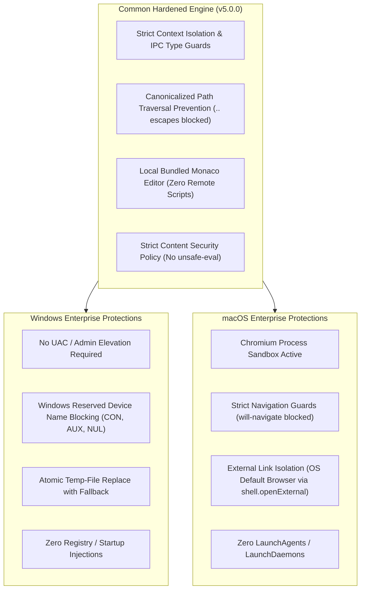

# mDiff — Enterprise Security & Compliance Report

**Prepared for**: Management, IT Security Directors, and Corporate Compliance  
**Application**: mDiff (Mavenir Diff) Comparison Suite (`v5.0.0`)  
**Target Deployment**: Corporate Laptops (Windows & macOS) & Internal Lab Servers (`10.10.84.22`)  
**Security Classification**: Air-Gapped / Zero-Telemetry / Portable User-Space Utility  

---

## 1. Executive Summary for Management

**mDiff** has undergone comprehensive defensive security auditing and source-level hardening to guarantee that it is safe to run on enterprise-managed corporate laptops and internal servers.

### Key Guarantees
1. **Zero Data Leaks / 100% Air-Gapped**: The application does not send telemetry, analytics, user data, file contents, or crash reports to external servers. It operates completely offline with no network access required.
2. **No Elevated Privileges (Zero Root / No Admin Required)**: mDiff runs entirely in user-space. It requires no Administrator (UAC) rights on Windows and no `sudo` privileges on macOS.
3. **No Background Services or Daemons**: mDiff does not install Windows Services, background tasks, startup registry keys, macOS LaunchAgents, or persistent daemons. When closed, zero processes remain active.
4. **Non-Destructive File Operations**: All file comparisons are strictly read-only by default. When the user explicitly requests a copy or save, operations are performed atomically with automatic timestamped backup copies (`.bak.timestamp`), eliminating risk of data loss.
5. **No External Code Execution**: All editor components (Monaco Editor and syntax parsers) are compiled locally into the application binary. Dynamic downloading of scripts from external CDNs (such as jsDelivr) has been completely removed.

---

## 2. Operating System Specific Security Protections

### A. Windows Environment (Corporate Windows Laptops)
- **Zero UAC Elevation**: mDiff is packaged as a portable application directory (`win-unpacked`). Employees can extract and run `mDiff.exe` directly from their standard user folder without IT helpdesk intervention.
- **Windows Reserved Device Name Sanitization**: Mitigates filesystem freeze vulnerabilities by explicitly detecting and rejecting access to legacy Windows device names (`CON`, `PRN`, `AUX`, `NUL`, `COM1-9`, `LPT1-9`).
- **Atomic File Writes**: Replaces files using temporary files and atomic renames, preventing truncated or locked files even during unexpected power loss or system interruption.
- **Null-Byte Injection Neutralization**: Prevents Windows path resolution bypasses that exploit null-terminator bytes (`\0`) in filenames.

### B. macOS Environment (Corporate MacBook / Mac Laptops)
- **Chromium Sandbox Active (`sandbox: true`)**: The renderer process runs strictly confined inside the macOS Chromium sandbox, preventing unauthorized access to the host operating system.
- **Navigation Lockdown**: The window interceptor (`will-navigate`) prevents dropped URLs or web links from redirecting the application window to external sites.
- **Controlled External URL Handling**: All external links are intercepted by `setWindowOpenHandler` and routed securely to the operating system's default browser (Safari, Chrome) via `shell.openExternal`, ensuring untrusted web content never renders inside the Electron window.
- **Clean Uninstallation**: mDiff leaves no persistent footprints in `/Library/LaunchDaemons` or system directories. To uninstall, simply delete the application folder.

---

## 3. Vulnerability Audit & Remediation Matrix

| Category | Potential Threat | mDiff v5.0.0 Mitigation |
| :--- | :--- | :--- |
| **Path Traversal** | Malicious paths escaping project root (`../../etc/passwd`) | Canonicalization algorithm collapses `..` and resolves symlinks before validating exact root containment. |
| **Data Exfiltration** | Outbound telemetry or background network beacons | Removed all external script sources (`https://cdn.jsdelivr.net`). Monaco is bundled 100% locally. CSP blocks unauthorized network origins. |
| **Process Privilege** | Privilege escalation or arbitrary command execution | Electron sandbox enabled (`sandbox: true`). Node integration disabled (`nodeIntegration: false`). Narrow preload bridge (`contextBridge`) with strict type-checked IPC channels. |
| **Prototype Pollution** | Malicious XML/JSON/YAML payloads corrupting JS prototypes | Attribute maps and AST nodes created via `Object.create(null)` with explicit blocking of `__proto__`, `constructor`, and `prototype`. |
| **Memory / DoS** | Massive files exhausting laptop RAM | Automated size warning threshold at 5 MB with preview truncation; large-file hashing performs chunked streaming with constant memory usage. |

---

## 4. Test Verification & Code Quality

- **Automated Regression Suite**: 81 / 81 unit tests passing cleanly across 12 test suites.
- **Security Specific Tests**:
  - `test/unit/path-security.test.ts`: Validates canonicalization, `..` escape rejection, and Windows reserved names.
  - `test/unit/safe-fs.test.ts`: Validates atomic saving, source/dest traversal rejection, and null-byte blocking.
  - `test/unit/xml.test.ts` & `test/unit/structured.test.ts`: Validates prototype pollution neutralization.
  - `test/unit/inline-diff.test.ts`: Validates box-free diff token extraction and safe rendering.
- **Static Analysis & Build**: Clean TypeScript compilation (`tsc --noEmit` and `tsc -p tsconfig.electron.json`) with zero type errors.
